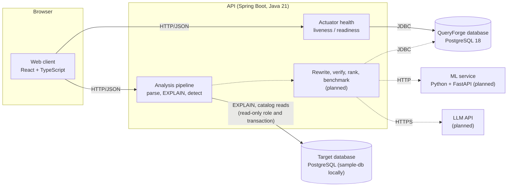

# Architecture

This document describes how QueryForge is put together today, how it is expected to grow, and why key decisions were made. Sections marked **Planned** describe intended design that is not yet implemented.

## System overview



Solid lines exist today. Dashed lines are planned.

## Components

### Web client (`apps/web`)

A single-page React application built with Vite and styled with Tailwind CSS.

- **Responsibilities:** presentation and user interaction only. It holds no optimization rules; it sends SQL and displays what the API computes.
- **API access:** all HTTP calls go through one client (`src/lib/api/client.ts`). It joins URLs safely, applies a timeout (overridable per request), supports cancellation, sends and parses JSON (including vendor types such as Actuator's), and turns non-2xx responses into a typed `ApiError`. Endpoint modules (`health.ts`, `analyses.ts`) build on it, and `problem.ts` reads the API's problem details, including mapping an error position back to a line of the submitted SQL.
- **Configuration:** `VITE_API_BASE_URL` sets the API location at build time. Vite reads it from the repository-root `.env`, and only `VITE_`-prefixed values reach the browser bundle.
- **Today:** a query workbench (sample queries, SQL input, estimate or execute mode), findings with copyable fixes, an EXPLAIN-style plan tree with each node's share of time or cost, the roadmap, and a live environment status panel.

### API (`apps/api`)

A Spring Boot 4.1 application on Java 21, organized as a modular monolith with one package per capability under `dev.queryforge.api`:

| Package | Responsibility |
| --- | --- |
| `parsing` | `QueryParser`: admits exactly one read-only query, using Calcite's Babel parser |
| `connection` | `TargetDatabase`: connection pool for the analyzed database; every unit of work is read-only, time-limited, and rolled back |
| `plan` | `ExplainRunner` and `ExplainJsonParser` capture and parse plans into `ExecutionPlan`/`PlanNode`; `PlanCosts` computes each node's own share |
| `analysis` | `AnalysisService` orchestrates the pipeline; `TableStatisticsReader` reads catalog facts; `detector/` holds one `BottleneckDetector` per finding type; `AnalysisController` serves `POST /api/v1/analyses` |
| `web` | CORS configuration and `ApiExceptionHandler`, which maps failures to RFC 9457 problem details with stable `code` values |

Packages depend in one direction (`analysis` → `plan` → `connection`, `parsing`), communicate through plain classes rather than shared state, and could be extracted later if there were a reason to. Planned packages: `rewrite`, `verification`, `benchmark`.

### PostgreSQL

There are two different roles for PostgreSQL, and keeping them separate is a core design rule.

| | QueryForge database | Target databases |
| --- | --- | --- |
| Purpose | QueryForge's own state (planned: analysis history, candidate rewrites, benchmark results) | Databases whose queries are being optimized |
| Access | Read/write, owned by the API, via Spring's `DataSource` | Read-only role, read-only transactions, statement timeout, small pool |
| Schema | Managed by migrations (Flyway, when the first table arrives) | Never modified by QueryForge |
| Today | Running via Compose; the API connects and reports health | One target, configured with `TARGET_DB_*`; locally the `sample-db` Compose service |

**Sample target database** (`infrastructure/sample-db`). A separate PostgreSQL server, because target databases belong to users, not to QueryForge. Init scripts create an e-commerce schema (customers, products, orders, order items), generate deterministic data with skewed distributions and correlated columns (`setseed`, scaled by `SAMPLE_SCALE`), run `ANALYZE`, and create the `queryforge_reader` role. Some indexes are left out on purpose so common bottlenecks appear. Tests build the same database at 2% scale with Testcontainers.

### Safety model for target databases

`EXPLAIN ANALYZE` executes the statement, and EXPLAIN cannot take the query as a bind parameter, so several independent layers keep analysis from changing anything:

1. **Query gate.** `QueryParser` accepts exactly one statement whose Calcite kind is a query (SELECT, WITH, VALUES, set operations). Data-changing statements, DDL, and stacked statements are rejected before a connection is opened. SQL Calcite cannot parse is rejected with the parser's position rather than passed through unchecked.
2. **Read-only transaction.** Every unit of work runs after an explicit `SET TRANSACTION READ ONLY` and is always rolled back, even on success. This holds even for a role with write privileges (tested by connecting as the database owner).
3. **Read-only role.** The sample's `queryforge_reader` has only `SELECT` grants and defaults to read-only transactions with a 30 s statement timeout.
4. **Statement timeout.** Set per transaction (`TARGET_DB_STATEMENT_TIMEOUT`, default 10 s) with `set_config(..., true)`, so pooled connections keep no state.
5. **Opt-in execution.** Plain EXPLAIN (estimates only) is the default; running the query requires `mode: execute`.

Target credentials are never logged or returned. When the target is unreachable, the API logs the driver error and returns a generic message, because driver messages can name hosts and users.

### Plan analysis

1. **Capture.** `EXPLAIN (FORMAT JSON)`, or `EXPLAIN (ANALYZE, BUFFERS, FORMAT JSON)` in execute mode, run with the session time zone set to `TARGET_DB_TIME_ZONE`.
2. **Parse.** Every node becomes a `PlanNode` with typed common fields (type, relation, costs, estimated rows, measurements) and the remaining EXPLAIN properties kept by name, so new detectors can use any property PostgreSQL reports without parser changes.
3. **Account for rows correctly.** PostgreSQL reports per-loop averages, and in parallel plans per-process figures. `ExecutionPlan` derives processes from the enclosing Gather, executions as loops per process, distinct totals (parallel-aware nodes split work; other nodes in a parallel section repeat it), and scales parallel estimates by the planner's parallel divisor. Detectors use these helpers instead of raw numbers.
4. **Read catalog facts.** Row estimates (`reltuples`) and the leading column of each index for the plan's tables, from the same transaction.
5. **Detect.** Each detector looks for one pattern and reports at most one finding per node, with a severity, an explanation that cites the plan's figures, and a suggestion where one is specific. Findings are ordered by severity.
6. **Rank nodes.** Each node's own share of total time (execute) or cost (estimate): inclusive figure minus children's. Shares are approximate, because PostgreSQL's accounting for subplans and parallel sections does not add up exactly.

### Planned: optimization pipeline

```text
SQL ─▶ Parse (Calcite) ─▶ Plan (EXPLAIN JSON) ─▶ Detect bottlenecks        [built]
    ─▶ Generate candidates (rules, LLM) ─▶ Verify equivalence (Z3 / differential testing)
    ─▶ Rank (learned cost model) ─▶ Benchmark top-k ─▶ Report                 [planned]
```

1. **Generate.** Deterministic rewrite rules produce candidates first. An LLM then proposes further rewrites, prompted with the query, the relevant schema, the plan, and the detected bottlenecks.
2. **Verify.** For a defined SQL subset (initially select-project-join queries with conjunctive predicates), the original and the rewrite are encoded as constraints, and Z3 searches for a counterexample. Outside that subset, differential testing runs both queries on generated data. A candidate that fails or cannot be checked is labelled as such and never presented as verified.
3. **Rank.** A learned model trained on plan features predicts relative performance, so only the most promising candidates are benchmarked.
4. **Benchmark.** Original and candidates run with warm-up and repeated measurement, reporting the distribution rather than a single number. Result sets are compared as a final equivalence check.

### Planned: ML service (`services/`)

A Python FastAPI service introduced in Phase 3, when the model needs Python's ML ecosystem (XGBoost, scikit-learn). It is stateless: the API sends plan features and receives predictions. Training runs offline from benchmark datasets. Until then there is no Python service, to avoid running a distributed system before it is needed.

## Configuration and secrets

- Every setting is an environment variable with a safe local default, except secrets, which have no committed default.
- One git-ignored `.env` at the repository root serves all three consumers:
  - Docker Compose reads it natively.
  - The API imports it with `spring.config.import: optional:file:../../.env[.properties]`, resolved from `apps/api`.
  - Vite reads it through `envDir: '../..'`.
- Precedence: real environment variables override `.env`. Deployed environments set variables directly and never ship a `.env` file.
- Both database ports are bound to `127.0.0.1`, so weak local passwords are not exposed to the network.

## Health and operability

| Endpoint | Includes | Used for |
| --- | --- | --- |
| `/actuator/health` | All components (`db`, `diskSpace`, `ping`, …) | Status overview, web status panel |
| `/actuator/health/liveness` | Process state only | Restart decisions; never fails because of the database |
| `/actuator/health/readiness` | Readiness state and `db` | Load-balancer routing; fails while the database is unreachable |

The API starts without a database and reports it through health instead of crashing. The Hikari connection timeout is 5 s, so health turns `DOWN` quickly. The target database is deliberately not part of health: it belongs to the user, and its outage should not mark QueryForge unready. Analysis requests report it as `503 target-unavailable` instead. Only `health` is exposed over HTTP. Browser access is limited to the configured CORS origins (`GET` for Actuator, `GET` and `POST` for `/api/**`).

## Testing strategy

- **Detectors and plan accounting** are unit-tested against EXPLAIN output captured from PostgreSQL 18 on the sample database (`src/test/resources/plans`), one fixture per plan shape, including a healthy plan that must produce no findings. Real plans catch details invented ones miss, such as fractional per-loop rows and per-process estimates in parallel plans.
- **Query gate** tests cover accepted PostgreSQL syntax (casts, `ILIKE`, `FILTER`, correlated subqueries) and every rejection path.
- **Safety** tests run `TargetDatabase` against PostgreSQL as the database owner and check that writes fail, the timeout and time zone apply, and failures are classified.
- **End to end**, `AnalysisApiTests` boots the API against a Testcontainers copy of the sample database built from the same init scripts and asserts the JSON contract and every error response.
- **Web** unit tests (Vitest) cover the API client, problem-detail handling, plan flattening, and formatting, with injected `fetch`.
- **CI** runs both suites, ESLint, and the production build on every push to `main` and every pull request.

## Architectural decisions

Short records of decisions that are not obvious from the code. Add new entries rather than rewriting old ones; mark superseded entries as such.

1. **Monorepo with independently built apps.** `apps/api` (Maven) and `apps/web` (npm) build with their native tools; there is no root build orchestrator. One repository keeps API contracts, docs, and CI changes in a single reviewable change, and two small toolchains are simpler than a polyglot build system.

2. **Modular monolith, not microservices.** All optimization stages live in one Spring Boot process with package-level boundaries. Stages share large in-memory structures (ASTs, plans) and are developed together, so network boundaries would add latency and failure modes without benefit. The ML service is the planned exception, justified by the Python ecosystem rather than by scale.

3. **Actuator for health instead of a custom endpoint.** Actuator provides aggregated component health, Kubernetes-style probes, and correct 503 semantics. Component details are hidden (`show-details: never`), and readiness depends on the database while liveness does not.

4. **One root `.env` for Compose, API, and web.** A single file avoids three drifting copies of the same values. The API imports it in Java properties format, so values must be unquoted (noted in `.env.example`).

5. **Real PostgreSQL in tests (Testcontainers), not H2 or mocks.** QueryForge's domain is PostgreSQL planner behavior, which an in-memory database cannot reproduce. Integration tests therefore require Docker, which GitHub-hosted runners provide.

6. **PostgreSQL 18, pinned in two places.** `compose.yaml` and `TestcontainersConfiguration` both use `postgres:18-alpine`, and comments in each point to the other. `EXPLAIN` output varies between major versions, so development and tests must match. PostgreSQL 18 images keep data under `/var/lib/postgresql/18/docker`, so the volumes mount `/var/lib/postgresql`.

7. **No ORM or migrations yet.** There is still no QueryForge schema, so the app database uses Spring JDBC only. Flyway arrives with the first table (analysis history). Whether to add JPA will be decided then; plan and analysis data may suit JDBC with explicit SQL better.

8. **TypeScript pinned to 6.0.** create-vite now scaffolds TypeScript 7 (the native compiler), but typescript-eslint supports TypeScript `<6.1`. TypeScript stays on 6.0 until typescript-eslint supports 7, so type-aware lint rules keep working.

9. **ESLint instead of the template's oxlint.** The project standard is ESLint, with type-aware rules (`recommendedTypeChecked`) to catch floating promises and unsafe `any` in API code.

10. **Restrictive defaults at the edges.** CORS allows only configured origins and the methods in use. Actuator exposes only `health`. PostgreSQL binds to loopback. Each will be widened deliberately when a feature needs it.

11. **The target pool is not a Spring `DataSource` bean.** `TargetDatabase` owns a private Hikari pool. As a bean it would make Spring Boot's DataSource auto-configuration back off, join the `db` health check, and risk being injected where QueryForge's own database is meant. Keeping it private makes the read-only transaction wrapper the only way to reach a target.

12. **Calcite as a gate, PostgreSQL as the authority.** Calcite (Babel parser, PostgreSQL lexical rules) decides only whether the text is one read-only query; the original text, not Calcite's rendering of it, is what PostgreSQL plans. Queries outside Calcite's grammar are rejected rather than sent unchecked: safety over coverage. The parse tree is kept for the rewriting and verification phases.

13. **Analysis sessions use UTC by default.** PgJDBC sets the session time zone from the API host's JVM, which silently changes the meaning of timestamp literals (`'2023-01-05'`) and therefore plans and row counts. Analysis sets `TARGET_DB_TIME_ZONE` (default `UTC`) per transaction so results do not depend on where the API runs.

14. **`commons-io` pinned to 2.20.** Calcite brings `commons-io` 2.15, which wins Maven's nearest-first resolution over the 2.20 that Testcontainers' `commons-compress` needs. The failure was silent: copying files into a container died in a background thread, so the sample database started empty. `dependencyManagement` pins the newer version, which Calcite also accepts.

15. **Detector fixtures are captured, not written.** Detector tests use EXPLAIN output captured from the sample database rather than hand-written JSON, so they encode PostgreSQL's real conventions. When PostgreSQL's output changes, re-capture the fixtures rather than editing them.

16. **Filter columns come from deparsed text, as a heuristic.** Index suggestions need the columns a scan filters on. Plain EXPLAIN prints scan filters with the scan's own columns unqualified and outer references qualified, which `FilterPredicates` relies on; expressions such as `lower(email)` are deliberately not treated as columns. Phase 1's Calcite work may replace this with predicates taken from the parse tree.
