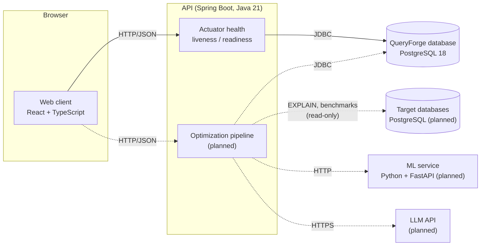

# Architecture

This document describes how QueryForge is put together today, how it is expected to grow, and why key decisions were made. Sections marked **Planned** describe intended design that is not yet implemented.

## System overview



Solid lines exist today. Dashed lines are planned.

## Components

### Web client (`apps/web`)

A single-page React application built with Vite and styled with Tailwind CSS.

- **Responsibilities:** presentation and user interaction only. It holds no business rules about query optimization; it sends SQL and displays results the API computes.
- **API access:** all HTTP calls go through one client (`src/lib/api/client.ts`). It joins URLs safely, applies a timeout, supports cancellation, parses JSON (including vendor types such as Actuator's), and turns non-2xx responses into a typed `ApiError`. Endpoint-specific modules, such as `health.ts`, build on that client.
- **Configuration:** `VITE_API_BASE_URL` sets the API location at build time. Vite reads it from the repository-root `.env`, and only `VITE_`-prefixed values reach the browser bundle.
- **Today:** a project overview and a live status panel that checks API and database health.
- **Planned:** SQL editor, execution-plan visualization, findings and rewrite review, benchmark results.

### API (`apps/api`)

A Spring Boot 4.1 application on Java 21, organized as a modular monolith under `dev.queryforge.api`.

- **Responsibilities:** owns all optimization logic, orchestrates the pipeline, talks to databases, and is the only component that holds credentials.
- **Today:** Spring Web MVC, Actuator health, and a JDBC `DataSource` for the QueryForge database. Health exposes component status (`db`, `diskSpace`, …) but not component details, so database product and connection information never leak.
- **Planned package layout:** one package per capability (`connection`, `parsing`, `plan`, `analysis`, `rewrite`, `verification`, `benchmark`), each owning its web layer, services, and persistence. Packages communicate through explicit service interfaces, so one could later be extracted if there were a reason to.

### PostgreSQL

There are two different roles for PostgreSQL, and keeping them separate is a core design rule.

| | QueryForge database | Target databases (planned) |
| --- | --- | --- |
| Purpose | QueryForge's own state: analysis runs, plans, candidate rewrites, benchmark results | The user's databases whose queries are being optimized |
| Access | Read/write, owned by the API | Read-only role, statement timeouts, per-connection limits |
| Schema | Managed by migrations (Flyway, from Phase 1) | Never modified by QueryForge |
| Today | Running via Docker Compose; the API connects and reports health | Not implemented |

**Planned safety model for target databases.** `EXPLAIN ANALYZE` *executes* the statement, so:

- Phase 1 accepts read-only `SELECT` statements only, validated by parsing, not string matching.
- Plain `EXPLAIN` (estimates only) is the default. Executing analysis and benchmarks require explicit opt-in.
- Every session sets `statement_timeout` and `default_transaction_read_only = on`, and runs inside a transaction that is rolled back.
- Target credentials are never logged, never returned by the API, and never sent to the LLM.

### Planned: optimization pipeline

```text
SQL ─▶ Parse (Calcite) ─▶ Plan (EXPLAIN JSON) ─▶ Detect bottlenecks
    ─▶ Generate candidates (rules, LLM) ─▶ Verify equivalence (Z3 / differential testing)
    ─▶ Rank (learned cost model) ─▶ Benchmark top-k ─▶ Report
```

1. **Parse.** Apache Calcite parses SQL into a relational algebra tree, giving rewrites and verification a structured representation instead of text.
2. **Plan.** `EXPLAIN (FORMAT JSON)` output is parsed into a typed plan tree: node type, estimated and actual rows, cost, buffers, and spill information.
3. **Detect.** Rules flag known bottleneck patterns, such as row-estimate errors, sequential scans behind selective predicates, nested loops over large inputs, and sorts or hashes that spill to disk.
4. **Generate.** Deterministic rewrite rules produce candidates first. An LLM then proposes further rewrites, prompted with the query, the relevant schema, the plan, and the detected bottlenecks.
5. **Verify.** For a defined SQL subset (initially select-project-join queries with conjunctive predicates), the original and the rewrite are encoded as constraints, and Z3 searches for a counterexample. Outside that subset, differential testing runs both queries on generated data. A candidate that fails or cannot be checked is labelled as such and never presented as verified.
6. **Rank.** A learned model trained on plan features predicts relative performance, so only the most promising candidates are benchmarked.
7. **Benchmark.** Original and candidates run with warm-up and repeated measurement, reporting the distribution rather than a single number. Result sets are compared as a final equivalence check.

### Planned: ML service (`services/`)

A Python FastAPI service introduced in Phase 3, when the model needs Python's ML ecosystem (XGBoost, scikit-learn). It is stateless: the API sends plan features and receives predictions. Training runs offline from benchmark datasets. Until then there is no Python service, to avoid running a distributed system before it is needed.

## Configuration and secrets

- Every setting is an environment variable with a safe local default, except secrets, which have no committed default.
- One git-ignored `.env` at the repository root serves all three consumers:
  - Docker Compose reads it natively.
  - The API imports it with `spring.config.import: optional:file:../../.env[.properties]`, resolved from `apps/api`.
  - Vite reads it through `envDir: '../..'`.
- Precedence: real environment variables override `.env`. Deployed environments set variables directly and never ship a `.env` file.
- The database port is bound to `127.0.0.1`, so a weak local password is not exposed to the network.

## Health and operability

| Endpoint | Includes | Used for |
| --- | --- | --- |
| `/actuator/health` | All components (`db`, `diskSpace`, `ping`, …) | Status overview, web status panel |
| `/actuator/health/liveness` | Process state only | Restart decisions; never fails because of the database |
| `/actuator/health/readiness` | Readiness state and `db` | Load-balancer routing; fails while the database is unreachable |

The API starts without a database and reports it through health instead of crashing. The Hikari connection timeout is 5 s, so health turns `DOWN` quickly. Only `health` is exposed over HTTP. Browser access is limited to the configured CORS origins and `GET`.

## Testing strategy

- **API.** `@SpringBootTest` integration tests run against a disposable PostgreSQL 18 container (Testcontainers with `@ServiceConnection`). They assert the health contract: database up and down, probes, hidden details, and the CORS allow-list. Future plan analysis will be tested against real `EXPLAIN` output from seeded databases.
- **Web.** Vitest unit tests cover the API client and health handling with injected `fetch`, without a browser or network.
- **CI.** GitHub Actions runs both suites, ESLint, and the production build on every push to `main` and every pull request.

## Architectural decisions

Short records of decisions that are not obvious from the code. Add new entries rather than rewriting old ones; mark superseded entries as such.

1. **Monorepo with independently built apps.** `apps/api` (Maven) and `apps/web` (npm) build with their native tools; there is no root build orchestrator. One repository keeps API contracts, docs, and CI changes in a single reviewable change, and two small toolchains are simpler than a polyglot build system.

2. **Modular monolith, not microservices.** All optimization stages live in one Spring Boot process with package-level boundaries. Stages share large in-memory structures (ASTs, plans) and are developed together, so network boundaries would add latency and failure modes without benefit. The ML service is the planned exception, justified by the Python ecosystem rather than by scale.

3. **Actuator for health instead of a custom endpoint.** Actuator provides aggregated component health, Kubernetes-style probes, and correct 503 semantics. Component details are hidden (`show-details: never`), and readiness depends on the database while liveness does not.

4. **One root `.env` for Compose, API, and web.** A single file avoids three drifting copies of the same values. The API imports it in Java properties format, so values must be unquoted (noted in `.env.example`).

5. **Real PostgreSQL in tests (Testcontainers), not H2 or mocks.** QueryForge's domain is PostgreSQL planner behavior, which an in-memory database cannot reproduce. Integration tests therefore require Docker, which GitHub-hosted runners provide.

6. **PostgreSQL 18, pinned in two places.** `compose.yaml` and `TestcontainersConfiguration` both use `postgres:18-alpine`, and comments in each point to the other. `EXPLAIN` output varies between major versions, so development and tests must match. PostgreSQL 18 images keep data under `/var/lib/postgresql/18/docker`, so the volume mounts `/var/lib/postgresql`.

7. **No ORM or migrations yet.** Phase 0 has no schema, so it uses Spring JDBC only. Flyway arrives with the first table in Phase 1. Whether to add JPA will be decided then; plan and analysis data may suit JDBC with explicit SQL better.

8. **TypeScript pinned to 6.0.** create-vite now scaffolds TypeScript 7 (the native compiler), but typescript-eslint supports TypeScript `<6.1`. TypeScript stays on 6.0 until typescript-eslint supports 7, so type-aware lint rules keep working.

9. **ESLint instead of the template's oxlint.** The project standard is ESLint, with type-aware rules (`recommendedTypeChecked`) to catch floating promises and unsafe `any` in API code.

10. **Restrictive defaults at the edges.** CORS allows only configured origins and `GET`. Actuator exposes only `health`. PostgreSQL binds to loopback. Each will be widened deliberately when a feature needs it.
